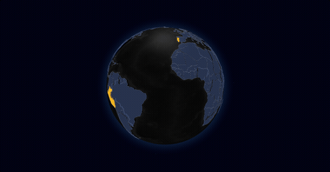
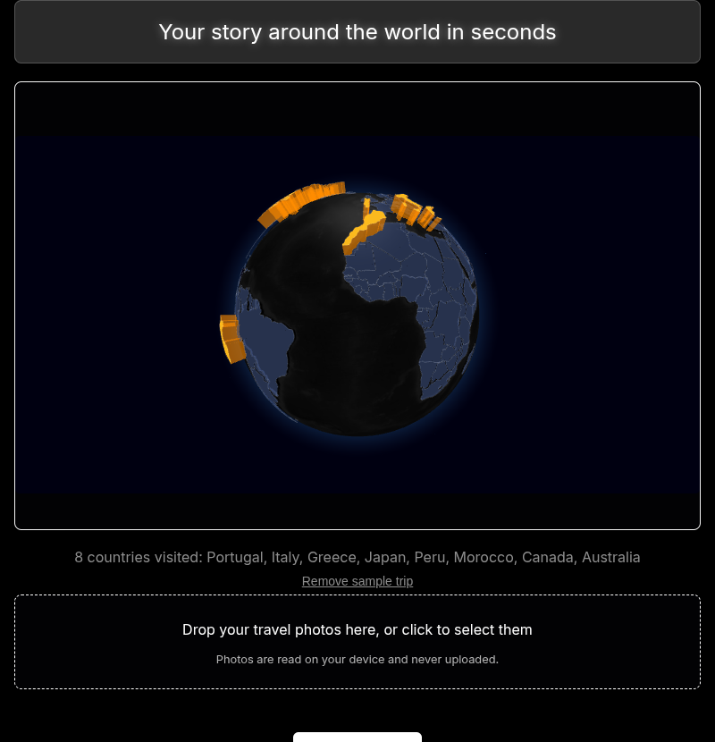
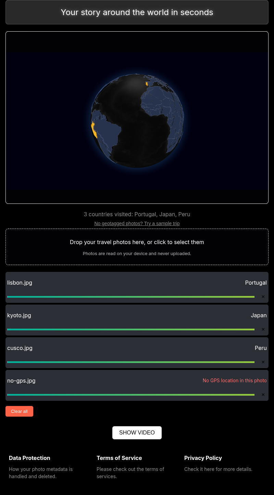
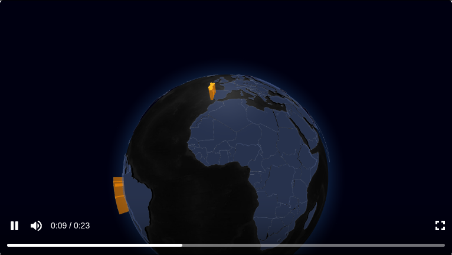
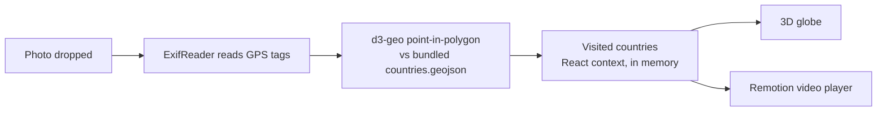

<div align="center">

# 🌍 Nomad Nexus

**Turn your travel photos into an interactive 3D globe and a shareable video recap, right in your browser.**

### [▶️ Live demo](https://cosminbmemetea.github.io/story/)

[](LICENSE)



</div>

> **No geotagged photos at hand?** Open the demo and click **"Try a sample trip"**.

## Screenshots

| Sample trip | Your own photos | Video recap |
| --- | --- | --- |
|  |  |  |

## Features

- **Drag-and-drop photos.** JPEG, PNG and HEIC photos are read with [ExifReader](https://github.com/mattiasw/ExifReader).
- **On-device country detection.** GPS coordinates are matched to a country with a point-in-polygon test ([d3-geo](https://github.com/d3/d3-geo)) against a bundled [Natural Earth](https://www.naturalearthdata.com/) dataset. No geocoding API is called.
- **Interactive 3D globe.** Built with [react-globe.gl](https://github.com/vasturiano/react-globe.gl) / three.js. Visited countries rise off the surface, and you can drag to spin and hover for details.
- **Video recap.** A 23-second [Remotion](https://www.remotion.dev/) composition (intro, title, then the globe) that plays in the browser, with optional cloud rendering on AWS Lambda.
- **Privacy by design.** Photos never leave your device, and nothing is stored. Refreshing the page clears everything.
- **Clear feedback.** Photos without GPS data, or with unreadable formats, get a clear message instead of failing silently.

## Tech stack

| Area | Tools |
| --- | --- |
| Framework | [Next.js 15](https://nextjs.org/) (App Router + static export), React 19, TypeScript |
| 3D / maps | react-globe.gl, three.js, d3-geo, Natural Earth 1:110m |
| Video | Remotion (Player, Studio, Lambda) |
| Photos | ExifReader, react-dropzone |
| Tooling | ESLint, Prettier |

## How it works



## Getting started

Requires **Node.js 20+**.

```bash
git clone https://github.com/CosminBMemetea/story.git
cd story
npm install
npm run dev          # http://localhost:3000
```

| Script | What it does |
| --- | --- |
| `npm run dev` | Start the Next.js dev server |
| `npm run build` | Production build (including the Remotion Lambda API routes) |
| `npm run build:pages` | Static export to `out/` for GitHub Pages (API routes excluded) |
| `npm run deploy:pages` | Build the static export and publish it to the `gh-pages` branch (the live demo) |
| `npm run lint` / `npm run typecheck` | ESLint / TypeScript checks |
| `npm run remotion` | Open Remotion Studio to edit the video composition |
| `npm run deploy` | Deploy the Remotion Lambda function and site (needs AWS credentials) |

### Optional: cloud video rendering (AWS Lambda)

The app and the demo need no configuration. To render MP4s in the cloud:

1. Copy `.env.example` to `.env` and add AWS credentials created with the [Remotion Lambda setup guide](https://www.remotion.dev/docs/lambda/setup). `.env` is git-ignored, so never commit it.
2. Adjust region and resources in `config.mjs`.
3. Run `npm run deploy`. Re-run it after changing the video, `config.mjs` or the Remotion version.

## Project structure

```
app/                 Next.js App Router: main page, layout, Lambda API routes
components/          UI components (photo dropzone, render controls, ...)
lib/                 Country dataset loading, point-in-polygon lookup, React context
pages/               Privacy policy, data protection and terms pages
public/              countries.geojson (Natural Earth) and globe texture
remotion/            Video composition (intro rings, title, globe)
scripts/             GitHub Pages static-export build and deploy scripts
docs/workflows/      Optional GitHub Actions workflows (CI and Pages), not enabled yet
```

## Deployment

- **GitHub Pages:** the demo at <https://cosminbmemetea.github.io/story/> is served from the `gh-pages` branch. To redeploy after changes on `main`, run `npm run deploy:pages`; it runs `npm run build:pages` and force-pushes the contents of `out/` to `gh-pages` (that branch only ever holds build output).
- **Automation (optional):** `docs/workflows/` holds a CI workflow (lint, typecheck, build, audit) and a Pages workflow. They are not active. To use them, copy them into `.github/workflows/` and set **Settings → Pages → Source** to **GitHub Actions**.
- **Vercel:** `vercel.json` deploys the full app, including the Lambda render API.

## Roadmap

- [ ] Cloud MP4 export and sharing, with visited countries passed to the render
- [ ] Trip timeline (order countries by photo date)
- [ ] Custom colours and themes

## Credits

- Country shapes: [Natural Earth](https://www.naturalearthdata.com/) (public domain).
- Globe texture and examples: [three-globe](https://github.com/vasturiano/three-globe) (MIT).
- Video: [Remotion](https://www.remotion.dev/). Some organisations need a [company license](https://www.remotion.dev/license) to use Remotion.

## License

[ISC](LICENSE) © Cosmin Memetea
